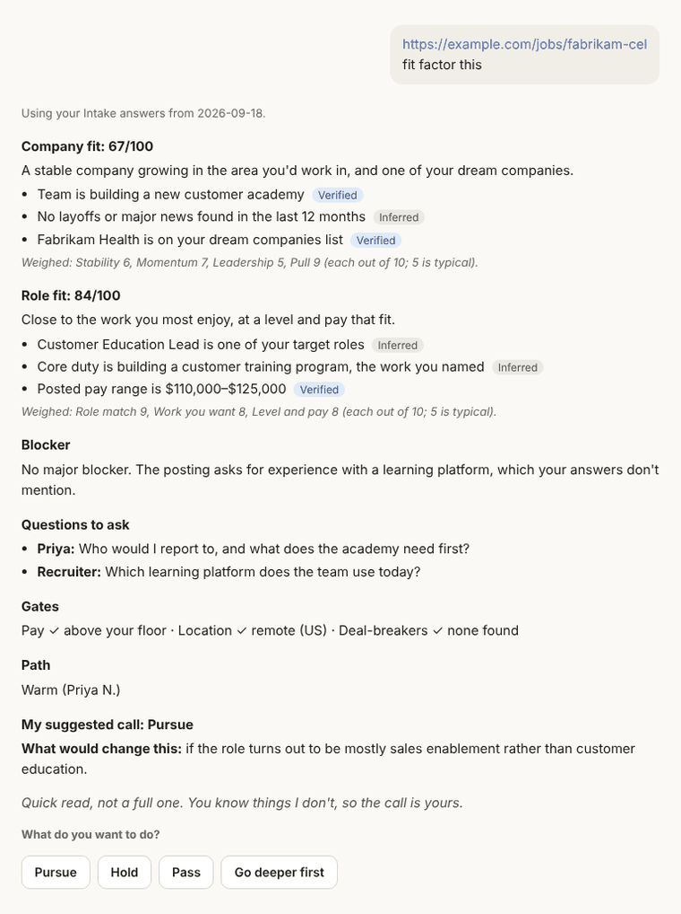
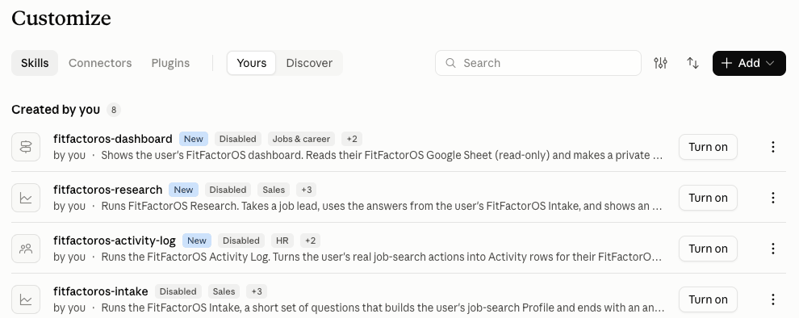

# Quick start: the Free plan

**Get your first job fit read in about 20 minutes.** This page covers the two parts of FitFactorOS you need first: **Intake** (a few questions about what you want) and **fit factor this** (an honest read on one job). Everything else can wait.

**Here's what you'll get at the end** (an example, with a made-up job):

Later, if you want, you can add a [dashboard and a morning email](../README.md#what-you-get) too.

**What you need**
- A computer. Setup is much easier on a laptop or desktop than on a phone.
- An email address for a free Claude account.
- One job you're curious about: the link is enough.

**What you don't need:** a paid plan, a GitHub account, a Google account, or any connections to your email or files. This is **Basic mode**: Claude gives you results, and you keep what you want by copying it. You can add more later, or never.

*Pictures in this guide were taken on a paid account in October 2026. The Free plan may look slightly different, and Claude's menus change from time to time.*

**You stay in charge.** FitFactorOS never sends, submits, or posts anything. It reads, researches, and writes drafts for you.

---

## 1. Make a free Claude account
Go to **[claude.ai](https://claude.ai)** and sign up. Choose the free plan if it asks.

*New to Claude?* It looks like a chat window: you type at the bottom, Claude answers above. The menu down the left side has your chats and **Projects**. On a small window, that menu may be hidden behind a button at the top left.

## 2. Turn on one setting
FitFactorOS won't work without this.

1. Click your name or initials at the bottom left, then **Settings**. A Settings window opens.
2. In its left menu, click **Capabilities**.
3. Under the **Code execution and file creation** heading, switch on **Cloud code execution and file creation**.
4. Close the Settings window with the **×** at its top right.

That's the only setting you need today. (The setup guide mentions other memory settings. You can skip them on the Free plan; step 6 below does the same job.)

## 3. Download two files
Click each link. The file downloads right away. You don't need a GitHub account.

- **[fitfactoros-intake.zip](https://github.com/jeremyjwalsh/fitfactoros/raw/main/dist/fitfactoros-intake.zip)**
- **[fitfactoros-research.zip](https://github.com/jeremyjwalsh/fitfactoros/raw/main/dist/fitfactoros-research.zip)**

Leave them as they are. **Don't open or unzip them.**

> [!IMPORTANT]
> **On a Mac with Safari, check your Downloads folder.** Safari often unzips files for you, so you see a **folder** called `fitfactoros-intake` instead of a file called `fitfactoros-intake.zip`. Claude can't use the folder. To fix it:
> 1. In **Finder**, open **Downloads**.
> 2. Hold **Control** and click the `fitfactoros-intake` folder (or right-click it).
> 3. Choose **Compress "fitfactoros-intake"**. A new file, `fitfactoros-intake.zip`, appears next to it. Use that one.
> 4. Do the same for `fitfactoros-research`.
>
> To stop Safari doing this next time: in Safari, click **Safari → Settings → General** and untick **Open "safe" files after downloading**. Or download with Chrome or Firefox, which don't unzip.

## 4. Add the two files to Claude
1. In the left menu, click **Customize** (or go to **[claude.ai/customize](https://claude.ai/customize)**). Make sure **Skills** is selected at the top.
2. Click the black **+ Add** button at the top right, then **Upload skill**.
3. Choose `fitfactoros-intake.zip` from your Downloads.
4. Do steps 2 and 3 again for `fitfactoros-research.zip`.
5. Click **Yours** (next to *Discover*, near the top) to see your own skills. Both FitFactorOS skills should be listed. If one says **Disabled**, click its **Turn on** button.

*Above: these skills are turned off, so each shows **Turn on**. Once turned on, the button goes away.*

The Skills page opens on *Discover*, a showcase of other skills. You can ignore it.

A "skill" is a set of instructions Claude follows when you ask for that task. You've just given Claude two of them.

## 5. Make a FitFactorOS Project
A Project is a folder in Claude that keeps your FitFactorOS chats and your answers together.

1. In the left menu, click **Projects** (or go to [claude.ai/projects](https://claude.ai/projects)).
2. Click **New project** (top right).
3. Under **What are you working on?**, type **FitFactorOS**. You can leave the other boxes empty.
4. Click **Create project**.

**Always use FitFactorOS from inside this Project.** If you're ever lost, click **Projects**, then **FitFactorOS**, and start a new chat there.

## 6. Tell it what you're looking for (Intake, about 10 minutes)
1. In your FitFactorOS Project, start a new chat.
2. Type **start my intake** and press Enter.
3. Answer the questions. Tap a choice or type. **You can skip any of them.**
4. At the end, Claude shows a block of your answers. **Save it in your Project** (Claude shows these steps too):
   - Tap **Copy** on the block.
   - Open your FitFactorOS Project page (click its name at the top of the chat, or go to **Projects → FitFactorOS**).
   - On the right of the Project page, find **Context** and click its **Add** button, then **Add text content**. (Not *GitHub* or *Drive*.)
   - In **Title**, type **My FitFactorOS answers**. Click in **Content** and paste.
   - Click **Add Content**.

This is how Claude remembers your answers in every new chat. You only do Intake once.

Claude will also mention a Google Sheet. **You can skip that today.**

## 7. Fit factor your job
1. In your FitFactorOS Project, start a **new** chat.
2. Paste the job link (or the job description itself) and type **fit factor this**.
3. Many job sites don't let Claude read the whole page. If that happens, Claude stops and tells you exactly how to copy the job description and paste it in. It won't guess.
4. If Claude asks to search the web or open a page, click **Allow**. That's the research.

You get **Company fit**, then **Role fit**, the biggest thing in your way, questions to ask, and a suggested call. Company fit looks at the company's stability, momentum, and leadership, and whether it's a company you're excited about. Role fit looks at whether you meet the must-haves, whether it's work you'd enjoy, and level and pay. ([What fit factor weighs](../README.md#what-fit-factor-weighs) has the details.) **The call is yours:** Pursue, Hold (come back later), or Pass.

Claude then gives you a row of text for a spreadsheet. On Basic mode, you can ignore it, or copy it into a note or document so you have a record of the jobs you've looked at.

**Going deeper.** For a job you're serious about, Claude may offer **Go deeper first**: a much fuller look at the company. **On the Free plan, one deep dive can use most of your usage until your limit resets, which can be a few hours.** Claude asks before it starts. Say **Not now** unless this is a job you'd really go after.

---

## When you hit a usage limit
The Free plan has a usage limit that **resets every five hours**, according to Anthropic's help center. When you reach it, Claude shows a message saying when you can continue.

- **Nothing is lost.** Your chats, your Project, and your saved answers stay put.
- **When the time comes,** go back to the **same chat** and type **keep going**. Don't start the job over; that uses more.
- **To make your usage last:**
  - Start a new chat for each job. Long chats use more, because Claude re-reads everything earlier in the chat each time.
  - If Claude asks for the job description, paste it in, so it doesn't have to hunt for it.
  - Let the quick read finish. Go deeper only on a job you'd really go after.

## If you get stuck

| What you see | What to do |
|---|---|
| The upload says it can't read the file | You probably uploaded a folder, not a .zip. See the Safari box in step 3. |
| You can't find the skills you uploaded | On the Skills page, click **Yours**, not *Discover*. |
| Claude doesn't seem to know FitFactorOS | Check step 2 (the setting is on) and step 4 (both skills switched on). Then start a new chat in your Project. |
| "I don't have your FitFactorOS answers yet" | Make sure you're in your FitFactorOS Project and that **My FitFactorOS answers** is listed under **Context** on the Project page (step 6). Or paste your answer block into the chat. |
| Claude says it can't search the web | Click **+** under the message box and look for a **Web search** switch. Turn it on and try again. |
| Claude says it could only read part of the posting | Follow its steps: on the job posting, select all (**Ctrl+A** on Windows, **Cmd+A** on Mac), copy, and paste it into the chat. |
| A message about a usage limit | See "When you hit a usage limit" above. |
| Anything asks for a GitHub account | You don't need one. Close that page and come back here. |
| Anything asks to send an email or change a file | Choose **Deny**. FitFactorOS never does either. |

---

## Later, if you want more
Everything below is optional. The [full setup guide](setup.md) covers each one.

- **Keep a record in a Google Sheet,** so every job you look at is saved in one place.
- **Log your job-search activity** and build a weekly work-search log for unemployment (Massachusetts first).
- **Connected mode:** let Claude read your Sheet to show a dashboard, or check your calendar and email for activity you forgot to log. Connecting Google is optional and you can disconnect any time. The setup guide explains exactly what the permission allows.

FitFactorOS is free and open source. It isn't made or endorsed by Anthropic. Questions or problems? Use the [feedback form](https://forms.gle/JAvtLkWR3unQQZQ77). No account needed.
