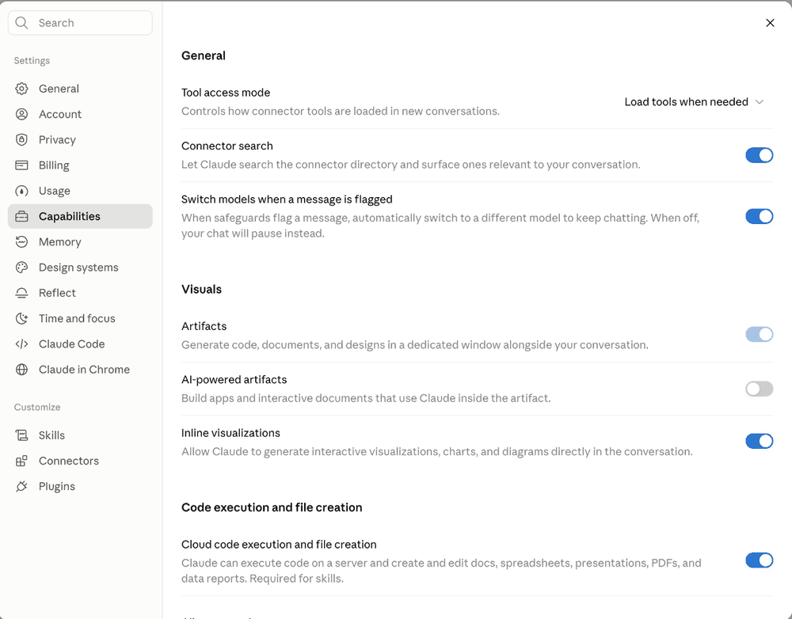
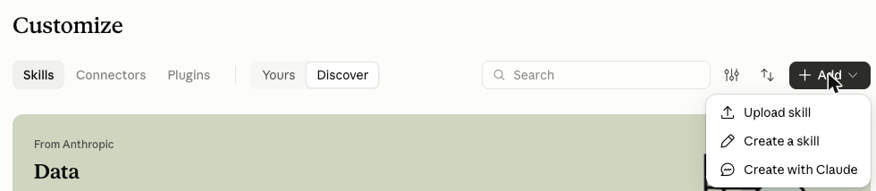
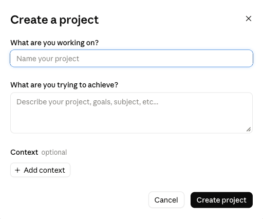
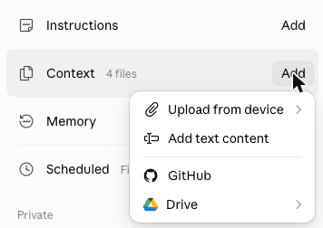
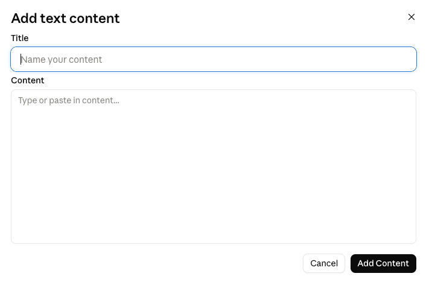
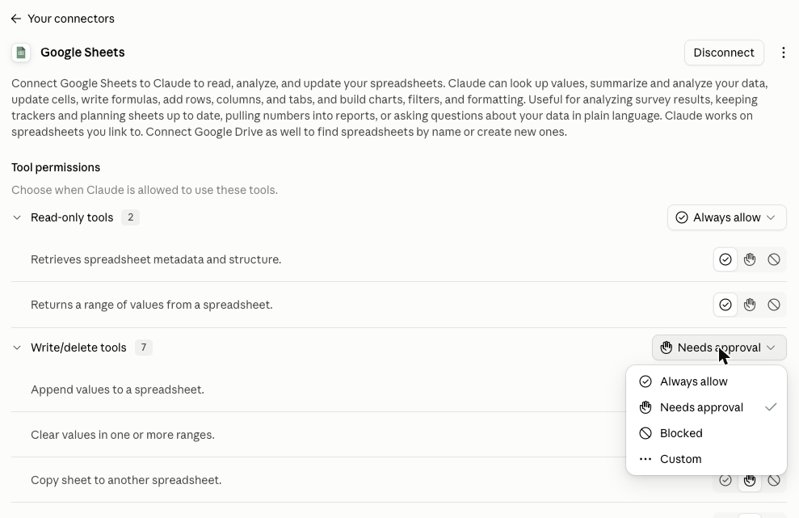

# Setup guide

> **On the Free plan, or new to Claude? Start with the [Free plan quick start](quick-start-free.md) instead.** It gets you to your first job fit read in about 20 minutes, with no Google connection and no GitHub. Come back here when you want more.
>
> Pictures were taken on a paid account in October 2026; the Free plan may look slightly different. Menu names in Claude change from time to time. If a step doesn't match what you see, tell us through the [feedback form](https://forms.gle/JAvtLkWR3unQQZQ77).

**Built for Claude.** FitFactorOS is built and tested on Claude. The rules are written in plain, open instructions (the SKILL.md format), so other AI tools can follow them too. In an early test with one job, ChatGPT followed the fit factor rules and reached the same suggested call as Claude, with scores within a few points. Two catches: ChatGPT only did this when told to read the skill files from GitHub first (just typing **fit factor this** got its own kind of score), and the other skills haven't been tried there. The one-click install, the dashboard page, and the morning email rely on Claude features and are Claude-only for now.

## Two ways to use FitFactorOS

| | **Basic** | **Connected** (optional) |
|---|---|---|
| What you connect | Nothing | Google, only the parts you choose (see step 8) |
| Intake and **fit factor this** | Yes | Yes |
| Your record of jobs and activity | Claude gives you rows; you paste them into your Sheet (or a note) | Same. FitFactorOS never changes your Sheet. |
| Dashboard page (**show my dashboard**) | Yes, if you copy your Sheet's tabs into the chat | Yes. With Google Sheets connected, Claude reads your Sheet itself. |
| **check my week** (finds activity you forgot to log) | No | Yes, with Gmail and Google Calendar connected |
| Morning email | No | Yes, with Gmail and Google Sheets connected |

**Everyone starts in Basic.** Intake and fit factor don't need any connections. Add Connected later, one piece at a time, if you want it.

## 1. Create or sign in to your Claude account
Go to [claude.ai](https://claude.ai) and sign up or sign in.

**Which plan?** FitFactorOS works on the Free plan. A paid plan (Pro, Max, Team, or Enterprise) gives you more room and a few extras.

| | Free plan | Paid plan (Pro or above) |
|---|---|---|
| Add FitFactorOS | Upload the skill files by hand (step 3) | The same, or the one-click plugin (step 3) |
| Get updates | Delete the old skills and upload the new files (see "Getting updates") | With the plugin: one click, **Check for updates** |
| Intake and fit factor this | Yes | Yes |
| **Go deeper** on a job | Yes, but **one deep dive can use most of your usage until your limit resets, which can be a few hours.** Claude asks first. Save it for a job you'd really go after. | Yes, with more room |
| Log activity, weekly log, dashboard, check my week | Yes | Yes |
| Morning email | Yes, when you say **morning email** | Yes, and it can arrive on its own every weekday |
| How Claude finds your Intake answers | From the answers you save in your Project (step 5) | The same, plus searching your past chats |
| Usage limits | Lower. The limit resets every five hours. | Higher |

What we checked in Anthropic's help center (October 16, 2026): skills, Projects (up to five on Free), memory, and Google connectors are available on the Free plan; searching past chats and scheduled tasks need a paid plan; the Free plan's usage limit resets every five hours. The plugin directory is listed for Pro and above. We haven't confirmed whether Free accounts can add a plugin, so on Free, use the skill files.

**On the Free plan, to make your usage go further:**
- Start a new chat in your Project for each task, so each chat stays short.
- If Claude asks for the job description, paste it in, so it doesn't have to hunt for it.
- Let the quick fit read finish. Go deeper only on jobs you're serious about.
- If you hit a limit, Claude tells you when you can continue. Come back to the same chat and say **keep going**.

## 2. Turn on the settings FitFactorOS needs
Click your name or initials at the bottom left of Claude, then **Settings**. In the Settings window, click **Capabilities**, and turn on:
- **Cloud code execution and file creation** (under the "Code execution and file creation" heading). Skills don't work without it.
- *Paid plans, optional:* **Search and reference chats**, so Claude can also look through your past chats in the Project. The Free plan doesn't have this setting, and you don't need it: step 5 saves your answers in your Project instead.



Research also uses **web search**. Claude normally searches on its own and may ask first; click **Allow**. If Claude says it can't search the web, click **+** under the message box and look for a **Web search** switch.

You don't need to connect anything to Google yet. That's step 8, and it's optional.

## 3. Add FitFactorOS to Claude

**Already added FitFactorOS another way?** Remove the old copy first, or two copies will both answer "fit factor this." In **Customize → Skills**, open each FitFactorOS skill and choose **⋮ → Delete**. Your Sheet and your Intake answers aren't affected.

### Free plan: add the skills by hand
You don't need a GitHub account for this. You're only downloading files.

1. Download the skills. Each download starts right away. **Don't open or unzip them.**
   - [fitfactoros-intake.zip](https://github.com/jeremyjwalsh/fitfactoros/raw/main/dist/fitfactoros-intake.zip) (needed)
   - [fitfactoros-research.zip](https://github.com/jeremyjwalsh/fitfactoros/raw/main/dist/fitfactoros-research.zip) (needed)
   - [fitfactoros-activity-log.zip](https://github.com/jeremyjwalsh/fitfactoros/raw/main/dist/fitfactoros-activity-log.zip) (add when you want to log activity)
   - [fitfactoros-dashboard.zip](https://github.com/jeremyjwalsh/fitfactoros/raw/main/dist/fitfactoros-dashboard.zip) (add when you want the dashboard page)
   - [fitfactoros-morning-email.zip](https://github.com/jeremyjwalsh/fitfactoros/raw/main/dist/fitfactoros-morning-email.zip) (Connected mode only)
2. In Claude's left menu, click **Customize** (or go to [claude.ai/customize](https://claude.ai/customize)), with **Skills** selected at the top.
3. Click the black **+ Add** button at the top right, then **Upload skill**, and choose one of the .zip files. Repeat for each one.
4. Click **Yours** (next to *Discover*) to see your own skills. If a FitFactorOS skill says **Disabled**, click its **Turn on** button.



> [!IMPORTANT]
> **Mac with Safari: you may have folders, not .zip files.** Safari often unzips downloads for you. If your Downloads folder shows a folder called `fitfactoros-intake` instead of `fitfactoros-intake.zip`, Claude can't use it. Hold **Control** and click the folder (or right-click it), choose **Compress "fitfactoros-intake"**, and upload the new .zip file it makes. Do the same for each skill.
> To stop this next time: **Safari → Settings → General**, untick **Open "safe" files after downloading**. Or download with Chrome or Firefox.

Anthropic's instructions: [Use skills in Claude](https://support.claude.com/en/articles/12512180).

### Paid plans: add the plugin instead (optional)
On Pro or above, you can add all five skills at once as a plugin, and get updates in one click. **You don't need a GitHub account.**

1. Go to [claude.ai/customize](https://claude.ai/customize) and click **Plugins**.
2. Click **Add** (top right), then **Add marketplace**.
3. Enter `jeremyjwalsh/fitfactoros` and click **Sync**. Leave **Sync automatically** off.
4. Click **Discover**. Find the **FitFactorOS** card (it may be partway down the page, under "New plugins") and click its **+**.
5. Click **Yours**. FitFactorOS should be listed under "From marketplaces you added." If it isn't, go back to step 4.

**Skip "Try in chat."** It opens a chat outside your FitFactorOS Project. Always use FitFactorOS from a new chat inside your Project.

Anthropic's instructions: [Plugins](https://claude.com/docs/plugins/overview).

## 4. Create your FitFactorOS Project
A Project is a folder in Claude that keeps your FitFactorOS chats and answers together.

1. In Claude's left menu, click **Projects** (or go to [claude.ai/projects](https://claude.ai/projects)), then **New project** (top right).
2. Under **What are you working on?**, type **FitFactorOS**, and click **Create project**.
3. Do everything below inside this Project.



**Permission prompts:** Claude may ask before it searches or reads a web page. **Allow** those; that's the research. FitFactorOS never sends, writes, or deletes anything, so if a prompt asks to send an email or change a file, choose **Deny**.

**Tip to save usage:** start a short new chat inside the Project for each task (one job, one log, one update). Long chats use up your Claude plan faster, because Claude re-reads everything earlier in the chat each time.

## 5. Run Intake (once)
1. Inside your FitFactorOS Project, start a new chat.
2. Type: **Start my intake**
3. Answer the questions. Skip anything you like.
4. At the end, Claude shows your answers in a block. **Save it in your Project:** tap **Copy**, open your Project page, find **Context** on the right and click its **Add** button, choose **Add text content** (not GitHub or Drive), type **My FitFactorOS answers** as the **Title**, paste into **Content**, and click **Add Content**. That's how Claude finds your answers in every new chat.





Your Profile is set. If something changes later, say **update my profile**. Claude tells you which line to change.

## 6. Fit factor a job (any time)
1. Inside your FitFactorOS Project, start a new chat. Paste the job link (or the job description itself) and type **fit factor this**.
   - Many job sites (Ashby, Workday, LinkedIn) don't let Claude read the whole page. If Claude can only read part of a page, it stops and asks for the text rather than guessing.
   - Scores can move a few points between runs on the same job. The suggested call is what to go by.
   - **Optional: Claude in Chrome.** This browser add-on lets Claude open job pages in your own Chrome, which helps on sites like Ashby and Workday. It acts in your real browser with your sign-ins, and it asks before opening a page. Skip it if you'd rather not; pasting the job description works just as well.
2. Claude shows **Company fit**, then **Role fit**, the biggest blocker, and a suggested call.
3. You decide: **Pursue**, **Hold** (park it and come back in a week), or **Pass**. When a job looks promising, Claude may also offer **Go deeper first**. It asks before starting, because going deeper uses much more of your plan (see the table in step 1).
4. Claude gives you a row for the **Jobs** tab of your Sheet (and, for Pursue, rows for the **Evidence** tab). No Sheet yet? Copy it into a note, or set up the Sheet in step 7.

If Claude says it doesn't have your answers, check that you're inside your FitFactorOS Project and that **My FitFactorOS answers** is listed under **Context** on the Project page (step 5).

## 7. Keep a record in your Sheet (optional)
The FitFactorOS Sheet keeps every job you look at, your evidence, and your activity in one place. You paste rows into it yourself. You need a Google account.

1. Download the Sheet: [fitfactoros-template.xlsx](https://github.com/jeremyjwalsh/fitfactoros/raw/main/sheet/fitfactoros-template.xlsx) (the download starts right away).
2. Go to [drive.google.com](https://drive.google.com), click **New → File upload**, and choose the file.
3. Double-click the uploaded file to open it.
4. **Click File → Save as Google Sheets.** A new copy opens in a new tab. Use that copy from now on.

> [!IMPORTANT]
> **Don't skip step 4: File → Save as Google Sheets.**
> The file you uploaded is an Excel file. It opens in Google Sheets, but some things won't work until you save it as a Google Sheet.
> **How to check:** an Excel file shows a small **.XLSX** tag next to its name at the top. A Google Sheet doesn't. If you see .XLSX, do step 4.
> You can delete the uploaded .xlsx file afterward.

5. On the **Profile** tab, click cell **B2** and paste your Intake answer block. Your answers fill B2 through B19.
6. On the other tabs, delete the grey example row when you're ready.

To add a row Claude gives you: click the first empty cell in **column A** of the tab it names, and paste.

**Your Dashboard tab** is a quick summary that fills in by itself as you paste rows. For the full view, add the **fitfactoros-dashboard** skill and say **show my dashboard**. Claude asks you to copy your tabs into the chat, or reads your Sheet itself in Connected mode (step 8).

## 8. Connected mode (optional, any time later)
Connecting lets Claude **read** parts of your Google account for three extras: the dashboard page without copying and pasting (Google Sheets), **check my week** (Gmail and Google Calendar), and the morning email (Gmail and Google Sheets). Connect only the ones you want. Intake and fit factor never need them.

**What the permission allows, plainly.** When you connect, Google shows a screen asking you to let Claude access that part of your account. That permission covers your whole account for that service, not just the FitFactorOS Sheet, and it can include changing things, not only reading them. According to Anthropic's help center, the Google connections can read your email, view and change calendar events, and work with your Drive files, and Claude can only reach what you can already reach in your own Google account. Sending email, and sharing, moving or deleting Drive files, ask for your approval by default.

**What FitFactorOS does with it.** FitFactorOS's instructions only read: it never sends, changes, labels, or deletes anything in your Gmail, Calendar, or Sheet. That's a rule FitFactorOS follows, not a limit Google enforces. If Claude ever asks to send an email or change a file during FitFactorOS, choose **Deny** and tell us through the [feedback form](https://forms.gle/JAvtLkWR3unQQZQ77).

**You can make it read-only yourself.** Each connector has **Tool permissions**: go to [claude.ai/customize/connectors](https://claude.ai/customize/connectors), click **Yours**, and click the connector. Its tools are split into **Read only tools** and **Write/delete tools**, and each group has a setting: **Always allow**, **Needs approval**, **Blocked**, or **Custom**. Set **Write/delete tools** to **Blocked**, and Claude can't change anything through that connection, whatever any instructions say. FitFactorOS works fine that way for **Google Sheets** and **Google Calendar**, because it only reads them. For **Gmail**, the morning email needs to save one draft, so if you use it, choose **Custom** and leave only the draft tool allowed.



*Above: the Google Sheets connector page, with the Write/delete tools menu open. Choose **Blocked**.*

If that's still more access than you're comfortable with, stay in Basic mode. Everything that matters most works without it.

**To connect:** go to [claude.ai/customize/connectors](https://claude.ai/customize/connectors) and connect the Google service you want. Or just ask for the feature (for example, **show my dashboard**) and Claude takes you to Google's sign-in when it needs it.

**To disconnect:**
1. Go to [claude.ai/customize/connectors](https://claude.ai/customize/connectors).
2. Click **Yours**, click the Google connector, then **Disconnect** (top right), and confirm.
3. To remove it on Google's side too: go to [myaccount.google.com/connections](https://myaccount.google.com/connections), find Claude, and remove its access.

The **Disconnect** button is at the top right of the connector's page (shown in the picture above).

Disconnecting doesn't touch your Sheet, your Project, or your answers. You're back in Basic mode.

Anthropic's instructions: [Use Google Workspace connectors](https://support.claude.com/en/articles/10166901).

## 9. Log your activity (any time)
Needs the **fitfactoros-activity-log** skill (step 3). Tell Claude what you did, inside your FitFactorOS Project: **"I applied to Northwind today"** or **"had coffee with Priya about Fabrikam."** Claude may ask a few quick questions (all skippable), then gives you a row for the **Activity** tab. Click the first empty cell in column A and paste.

*Connected mode:* if **Google Calendar** is connected, Claude fills in details from that day's calendar (Zoom or phone, names, email addresses, and any next interview already booked) and tells you what it used. Missed a few things? Say **check my week**. Claude reads your calendar and email for the week, lists what looks like job-search activity you haven't logged, and asks about each one. Only what you confirm becomes a row.

## 10. Build your weekly log
Say **"this week's work search log."** Claude asks you to copy your **Activity** and **Jobs** tabs into the chat (copying the whole tab is fine). *Connected mode:* with Google Sheets connected, Claude reads them itself, and with Gmail or Google Calendar connected, it first offers to check for anything you haven't logged. You get:
- a log in your state's format, ready to copy into your weekly certification,
- a count against your state's weekly minimum, and a plain warning if you're short,
- rows to add to your Activity tab, so your records stay complete.

Every job you fit factored that week shows up as a job posting you reviewed, even ones you passed on. Looking at jobs is part of looking for work.

**Claude never submits your certification. You do that yourself.** FitFactorOS has rules for **Massachusetts** so far. In other states you still get the log, but "Counts for unemployment" stays blank. This isn't legal advice; check your state's unemployment agency for what it requires.

## 11. Optional: the morning email (Connected mode)
A one-minute weekday email that lands in your Gmail **Drafts**: how you're doing, what needs attention, and the one thing to do today, with a quote, a song, or something funny at the top. It's a draft to you and is never sent.

1. Add the **fitfactoros-morning-email** skill (step 3) and connect **Gmail** and **Google Sheets** (step 8).
2. In your FitFactorOS Project, say **set up my morning email** and answer four quick questions. All can be skipped.
3. Paste the 4 answers it gives you into your Sheet's **Profile** tab, starting at **B20**.
4. On Pro and above, Claude sets it up as a weekday scheduled task and makes your first one right away. On the Free plan, say **morning email** any morning to get the same draft.

Look for it in **Drafts**, not your inbox. Old drafts aren't deleted for you, so delete each one after you read it. On a phone, Gmail can't open links inside a draft. To stop, say **stop my morning email**.

## Things you can say

The one-page [cheat sheet](cheat-sheet.md) groups these by when you'd use them.

| Say this | What happens |
|---|---|
| **start my intake** | Builds your Profile (about 10 minutes) |
| **update my profile** (or "change my pay floor," "add a contact") | Changes one answer |
| **fit factor this** + a job link | Company fit, then Role fit, then you decide |
| **go deep** | Deeper research on a job you're serious about. Claude asks first, because it uses much more of your plan. |
| **log this** (or "I applied to…," "I had a call with…") | Activity rows to paste |
| **this week's work search log** | Your weekly unemployment log |
| **did I do enough this week?** | Your count against your state's minimum |
| **check my week** (or "what did I miss?") | *Connected mode.* Checks your calendar and email for activity you haven't logged, and asks before adding anything |
| **show my dashboard** (or "where do I stand?") | Your top picks, ladders, and this week, on a private page |
| **set up my morning email** | *Connected mode.* An optional weekday email draft with your one next move |
| **morning email** | Today's email draft, any time |
| **stop my morning email** | Turns the weekday email off |

## Getting updates
FitFactorOS is still being built, and the skills get improved. See [CHANGELOG.md](../CHANGELOG.md) for what changed.

**If you added the skills by hand:**
1. Download the new .zip files using the links in step 3 (check the Safari note there).
2. In Claude, go to **Customize → Skills**, delete the old FitFactorOS skill (**⋮ → Delete**), and upload the new one.

**If you added the plugin (paid plans):**
1. Go to **Customize → Plugins**, click **Add**, then **Manage marketplaces**.
2. Click the **⋮** next to **fitfactoros**, then **Check for updates**.
3. Start a new chat in your Project to use the new version. Chats you already had open may keep the old one.

*Only if you already use GitHub:* you can turn on **Sync automatically** in that same menu so updates arrive on their own. Claude asks you to give its GitHub app access first. Everyone else can ignore this; **Check for updates** does the same job.

Your Sheet and your answers stay as they are. You don't need to run Intake again.

### Fixes for older Sheets
Only if you set up your Sheet before these updates.

**Before the Activity Log came out:** on the **Activity** tab:
1. Type these headers: **M1** Pay rate, **N1** Employer address, **O1** Contact info.
2. Select column D, click **Data → Data validation**, and add **Reviewed job posting** to the list.

**Before the October 15 (night) update:** on the **Dashboard** tab, click **B10** and replace what's there with:

```
=IF(B8>=B9,"On track","Need "&(B9-B8)&" more")
```

Then click **D10** and replace the note with: *Counts only Activity rows marked Yes. Screened jobs count once your weekly log adds them as Reviewed job posting rows.*

**Profile tab with no labels in rows 20 to 23:** type **Morning email sparks**, **Sign (optional)**, **Morning email ready by**, and **Dashboard link** into A20 through A23 first, and move any notes in those rows further down.

## Want to go further?
New to Claude, or curious how the pieces fit? [Want to go further?](learn-more.md) has a few free official Anthropic courses and help pages on Projects, Skills, and scheduled tasks.

## Coming in later phases
The Job Finder and Outreach come next. Later, Claude will add rows to your Sheet for you after you OK them, so you won't have to paste them. See the [Roadmap](../README.md#roadmap).

## Your data
Your answers are saved in your Claude Project and, if you use it, your own Google Sheet. FitFactorOS has no server of its own and collects nothing. Your chats with Claude go through Anthropic like any Claude chat, and if Claude's memory feature is on, Claude may remember details between chats. You can control that in Claude's settings. Anthropic's privacy policy covers the rest.
